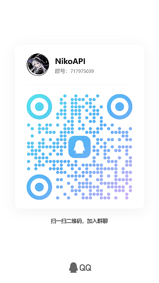
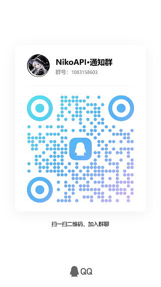
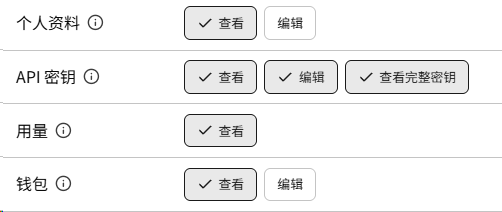

# dsh-nikoapi

**English** · [简体中文](README.md)

 

## Foreword

This plugin exists to make the [NikoAPI](http://nikoapi.xyz) relay convenient to use. It is written by a member of the site's community group, as a labour of love — feedback and suggestions are welcome.

Questions about the API itself go to the group owner; the author only maintains and updates the plugin itself. If you want to be certain, review the code for safety before installing. Should a key leak or another security problem occur, the author is sincerely sorry but accepts no responsibility.

Site chat groups — click or scan to join:

[Official chat group](https://qm.qq.com/q/OsKxIZL9Ck)



[Official notice group](https://qm.qq.com/q/jArGMUFuKI)



Connect NikoAPI model Keys to DeepSeek Harness: pick Keys and models in Settings, press **Confirm**, and the models appear in DSH's model picker. With `dsh-cost-meter` installed, price calculators register automatically.

|                      |                                              |
| -------------------- | -------------------------------------------- |
| DSH version          | `>= 0.2.2-rc.1 < 0.3.0`                      |
| Node.js              | `>= 20`                                      |
| Runtime dependencies | none (Node built-ins and DSH Host APIs only) |
| License              | MIT                                          |

## Install

**Option 1 (recommended):** install the package `dsh-nikoapi` through DSH's plugin manager, then confirm the plugin row is enabled.

**Option 2:** add the dependency to your profile's `package.json`, reinstall, and restart DSH:

```json
{ "dependencies": { "dsh-nikoapi": "^0.1.0" } }
```

Restart DSH after installing; once **NikoAPI** appears in Settings, the install worked.

> A local `link:` install bypasses the `files` whitelist (everything in the directory is linked), so only an install **from npm** actually proves the packed file list is complete.

> The site address defaults to `https://nikoapi.xyz`; a self-hosted relay can change `baseUrl` in the plugin config.

## Quick start

1. Register and sign in on the main site.
2. After signing in, create an access token in the console under [Security & access](https://nikoapi.xyz/security). The recommended permission set lets the plugin use all of its features.
3. **DSH → Settings → NikoAPI → Connection**: paste the **management token** and press **Save**.
4. **Keys and groups** tab: press **Refresh** to load the remote Key directory. Only an explicit refresh goes to the network; otherwise the last synchronized cache is shown.
5. Select the model Keys to add, then press **Confirm**.
6. **Models** tab: preview the models available on the selected Keys, select them, and press **Confirm** again. The plugin reads back the credential, site address, capabilities, and exact model IDs before it creates one route per Key.

## One Key, one Provider

- Each Key gets exactly one route, with the stable ID `nikoapi-<Key ID>`. A Key is never split into multiple Providers.
- Protocols are aggregated per group, in priority order: `openai-responses` → `anthropic-messages` → `google-generative-ai` → `openai-completions`.
- Explicit GPT model IDs always use `openai-responses`, even when the site omits that declaration. This is the only model-ID protocol override.
- Every confirmed model on a Key shares that single protocol, so **keep mixed selections within what that protocol supports**.
- Models with the same ID are added per Key; each channel uses its own Key and group, and the current session's default model is never changed.

## Token permissions

Recommended token permissions:



Without `api_key:write` the group picker is read-only; everything else still works.

## Cost link

The plugin is linked with the `dsh-cost-meter` cost plugin, providing accurate accounting of site prices and balance queries.

Active automatically when `dsh-cost-meter` 1.9.78 or later is present; no checkbox needed. Without cost-meter the plugin still works, just without prices.

- Calculators are registered only for confirmed, enabled **exact** models whose routes passed verification.
- Model refreshes and the scheduled rate refresh both update rates; the Key directory is not reloaded by them and updates only through **Refresh**.
- The **Cost link** tab sets the rate-refresh interval (15 minutes by default) and offers **Refresh now**.
- When cost-meter is detected and its "billion-context assisted metering" switch is on, the plugin turns it off once (at most once per start; turning it back on later is not overridden). Reason: with that switch on, cost-meter replays skip the plugin's stored CNY quotes and fall back to official USD prices, so per-turn details no longer match.
- Beyond that, the plugin never modifies cost-meter's price configuration, balances, or recorded ledger entries.

## Credentials and privacy

- The management token and model Keys live in DSH's local credential store and are written one way; the UI never echoes them.
- Apart from the NikoAPI site itself, the plugin sends data nowhere.

## Troubleshooting

- **Keys and groups shows "Not connected"**: the token was not saved or has expired. Use **Update credential** to re-enter it.
- **"The plugin is updating; restart DSH and refresh the page"**: module generations differ after an upgrade. Restart DSH.
- **"The service is temporarily unavailable"**: refresh the page or restart DSH, then retry.
- **No prices**: `dsh-cost-meter` 1.9.78+ is missing, or the model is not confirmed or its route failed verification.

## Development

```bash
npm test   # uses a local mock site and never reaches the network
```

## Feedback and suggestions

- Repository: <https://github.com/SnowNight777/dsh-nikoapi>
- Issues: <https://github.com/SnowNight777/dsh-nikoapi/issues>

## License

MIT © SnowNight777