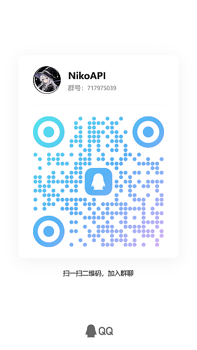
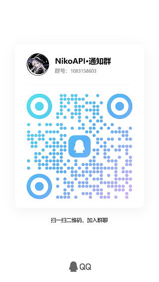
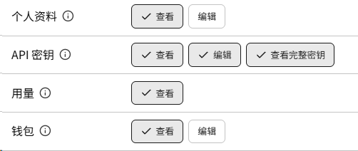

# dsh-nikoapi

[English](README.en.md) · **简体中文**

 

## 前言

本项目是为方便 [NikoAPI ](http://nikoapi.xyz) 中转站开发的便携插件，作者是站内的群友，插件纯为爱发电制作而成，欢迎大家使用以及提出建议和意见。

如遇到API使用的相关问题进群找群主，本人只负责插件本身的维护和更新，不放心的请在安装前请进行安全审查，如有遭遇key泄露等安全问题深感抱歉但本人概不负责。

站内群聊链接，点击或扫码加入：

[官方聊天扯淡群](https://qm.qq.com/q/OsKxIZL9Ck) 



[官方通知群](https://qm.qq.com/q/jArGMUFuKI) 



把 NikoAPI 的模型 Key 接进 DeepSeek Harness：在设置里勾选 Key 与模型、点「确认」，模型就直接出现在 DSH 的模型选择器里。装了 `dsh-cost-meter` 的话，价格计算器也会自动挂上。

|         |                               |
| ------- | ----------------------------- |
| DSH 版本  | `>= 0.2.2-rc.1 < 0.3.0`       |
| Node.js | `>= 20`                       |
| 运行时依赖   | 零（只用 Node 内置模块与 DSH Host API） |
| 许可证     | MIT                           |

## 安装

**方式一（推荐）**：在 DSH 里用插件管理安装本包（包名 `dsh-nikoapi`），装好后确认插件行已启用。

**方式二**：把依赖写进 profile 的 `package.json`，重装并重启 DSH：

```json
{ "dependencies": { "dsh-nikoapi": "^0.1.0" } }
```

装完重启 DSH，设置里出现 **NikoAPI** 即安装成功。

> 本地用 `link:` 指向源码目录时，`files` 白名单不生效（目录里有什么就都有），所以只有**从 npm 安装**才能真正验证包里文件齐不齐。

> 站点地址默认是 `https://nikoapi.xyz`；自建中转可以在插件配置里改 `baseUrl`。

## 快速开始

1. 前往主站注册并登录账号
2. 登录成功后在控制台 → [安全与访问](https://nikoapi.xyz/security) 中创建访问令牌，权限建议按推荐配置，推荐配置可以使用完整插件功能。
3. **打开DSH → 设置 → NikoAPI →「连接设置」**：粘贴**管理访问令牌**，点「保存」。
4. **「Key 与分组」** 标签：点「刷新」拉取远端 Key 列表。只有主动刷新才会联网，平时显示「上次同步」的缓存。
5. 勾选要接入的模型 Key，点「确认」。
6. **「模型」** 标签：预览所选 Key 的可用模型，勾选后再次「确认」。插件会读回校验凭据、站点地址、能力与精确模型 ID，然后为每个 Key 建立一条路由。

## 一个 Key = 一条 Provider

- 每个 Key 严格只建一条路由，ID 固定为 `nikoapi-<Key ID>`，不会把一个 Key 拆成多个 Provider。
- 协议按分组聚合，优先级：`openai-responses` → `anthropic-messages` → `google-generative-ai` → `openai-completions`。
- GPT 模型 ID 固定走 `openai-responses`，即使站点漏报该声明——这是唯一按模型 ID 覆盖协议的规则。
- 同一 Key 下所有已确认模型共用这一个协议，所以**混选模型请限制在该协议支持范围内**。
- 同名模型按 Key 分别接入；每个渠道使用对应 Key 与分组，不改变当前会话的默认模型。

## 令牌权限

推荐令牌权限：



没有 `api_key:write` 时分组选择为只读，其余功能不受影响。

## 费用联动

本插件目前已与dsh-cost-meter费用插件联动，实现站内价格的精确统计和余额查询功能。

检测到 `dsh-cost-meter` 1.9.78 或更高版本时自动生效，无需勾选；没有 cost-meter 也能正常使用，只是没有价格。

- 只为**已确认、Key 已启用且路由校验通过**的精确模型注册同步价格计算器。
- 模型刷新与费率定时刷新都会更新费率；Key 列表不随之重载，由「刷新」按钮更新。
- 「费用联动」标签可改费率刷新间隔（默认 15 分钟）与「手动刷新」。
- 检测到 cost-meter 时，若其「billion-context 辅助计量」开关是开的，会自动关一次（每次启动最多一次，你之后手动开回不会被反复覆盖）。原因：开启时 cost-meter 回放会跳过本插件已存的人民币报价、改用官方美元价，回合明细对不上。
- 除此之外不修改 cost-meter 的价格配置、余额与已记录的账单。

## 凭据与隐私

- 管理令牌与模型 Key 保存在 DSH 本机凭据库，界面单向保存、不回显。
- 除 NikoAPI 站点本身，插件不向任何第三方发送数据。

## 常见问题

- **「Key 与分组」显示未连接**：令牌未保存或已失效，用「更新凭据」重填。
- **提示「插件正在更新，请重启 DSH 并刷新页面后重试」**：插件升级后模块代际不一致，重启即可。
- **提示服务暂不可用**：刷新页面或重启 DSH 后重试。
- **没有价格**：未安装 1.9.78 以上的 `dsh-cost-meter`，或模型尚未确认、路由未通过校验。

## 开发

```bash
npm test   # 内置本地 mock 站点，不访问公网
```

## 问题反馈及建议

- 仓库：<https://github.com/SnowNight777/dsh-nikoapi>
- 问题反馈：<https://github.com/SnowNight777/dsh-nikoapi/issues>

## 许可

MIT © SnowNight777